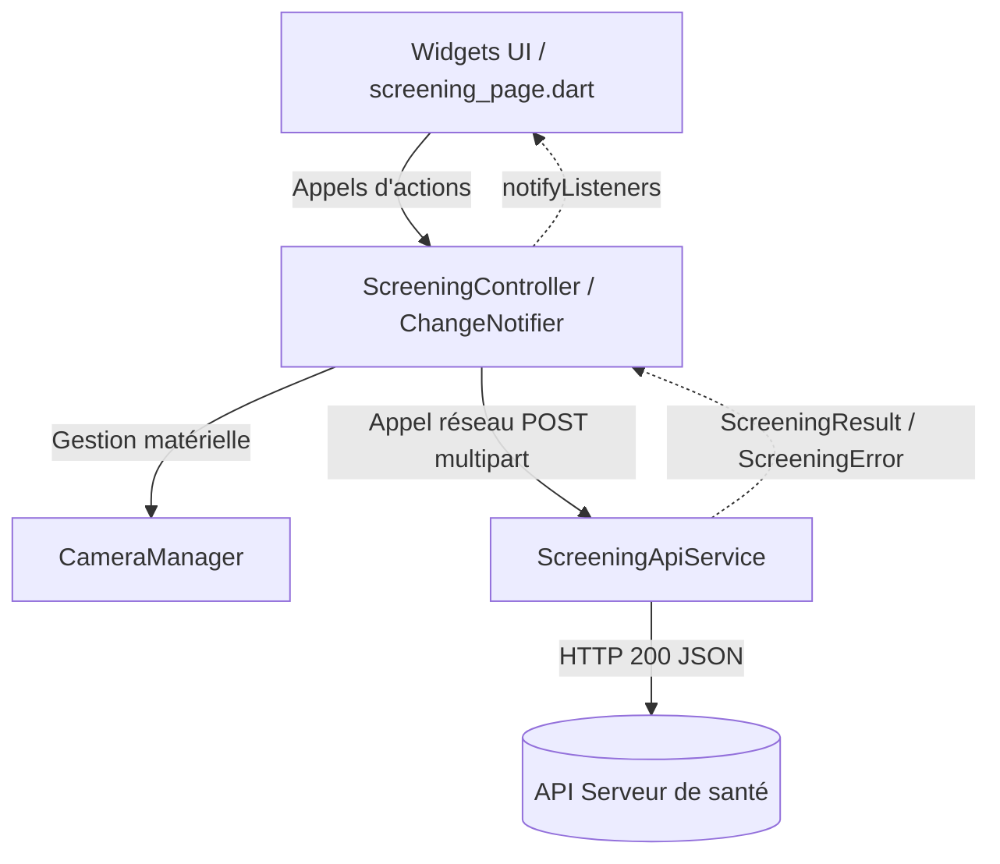
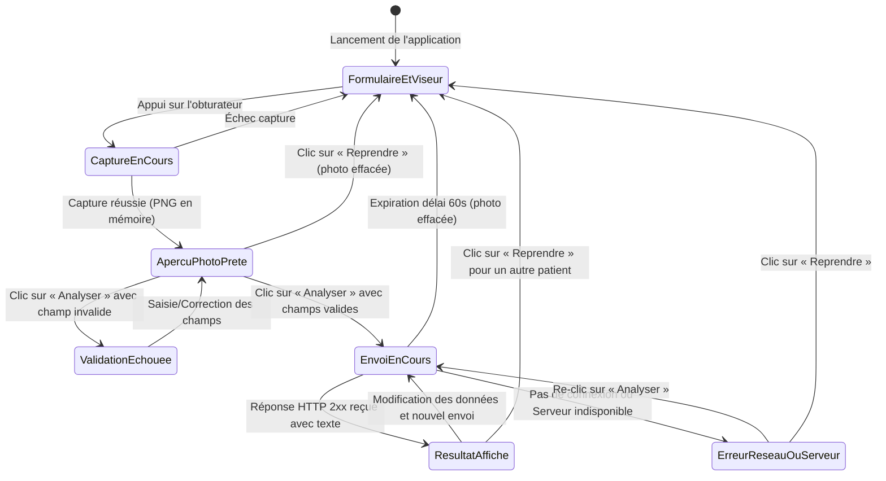
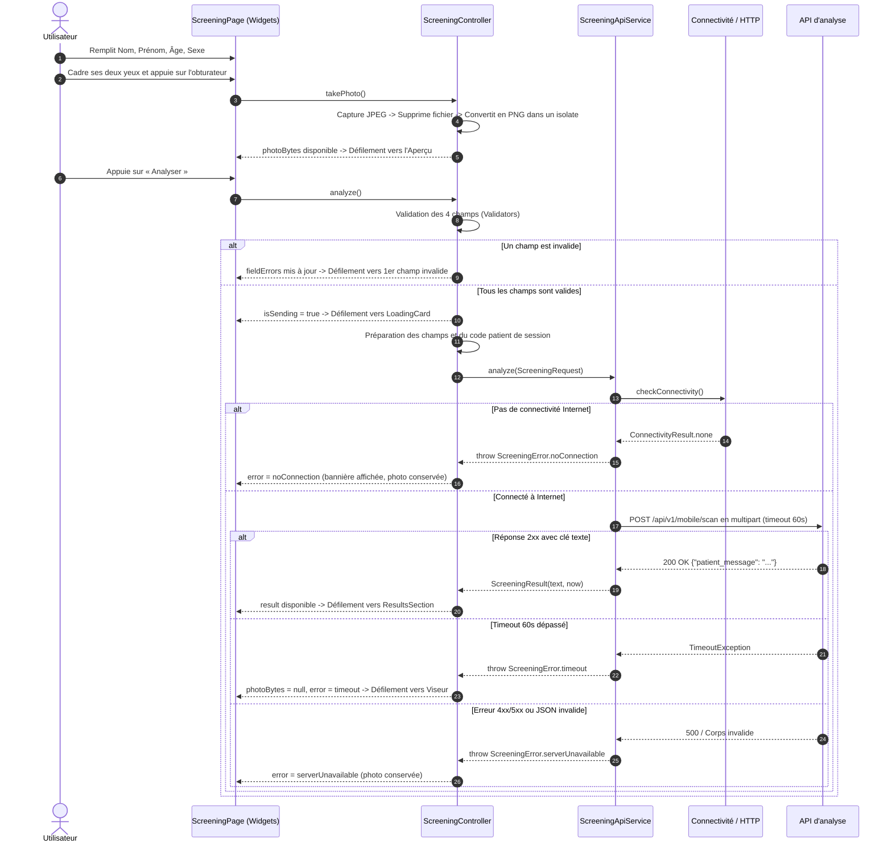

# Architecture logicielle — Dépiste Retino

> **À quoi sert ce document :** Présenter les couches, les responsabilités de chaque module, les flux de données, les diagrammes de séquence et d'états du projet Flutter Dépiste Retino.  
> **Pour qui :** Les développeurs mobiles et l'équipe technique en charge de la maintenance.

---

## 1. Principes architecturaux

L'application est structurée selon une **architecture en couches unidirectionnelle** (3 couches : Data, Logic, UI) centrée autour de l'unique fonctionnalité `screening`.
- **UI (Présentation) :** Widgets Flutter déclaratifs, sans aucune logique métier, observant l'état via `Provider`.
- **Logic (Métier / Contrôleur) :** Gestion d'état avec un unique `ChangeNotifier` (`ScreeningController`) et un gestionnaire de matériel caméra (`CameraManager`).
- **Data (Accès aux données) :** Modèles de transfert multipart et client HTTP (`ScreeningApiService`) avec politique d'expiration de 60s.

---

## 2. Responsabilités des fichiers

| Chemin | Rôle et responsabilité |
|---|---|
| `lib/main.dart` | Point d'entrée : verrouillage portrait, style de barre système, Provider racine. |
| `lib/app.dart` | `MaterialApp`, configuration du thème clair, bridage de l'échelle texte (1.0 à 1.3). |
| `lib/core/config/api_config.dart` | URL, chemin, clé d'authentification (`--dart-define`), délai de 60s. |
| `lib/core/constants/app_strings.dart` | Centralisation de l'intégralité des textes en français de l'interface. |
| `lib/core/constants/app_dimens.dart` | Rayons (32, 16, 26, 9999), espacements, hauteurs tactiles (56px). |
| `lib/core/theme/app_colors.dart` | Palette Stitch, constantes hexadécimales et valeurs ARGB précalculées. |
| `lib/core/theme/app_text_styles.dart` | Styles typographiques Plus Jakarta Sans (tailles, graisses, hauteurs de ligne). |
| `lib/core/theme/app_shadows.dart` | Définitions des ombres portées douces (cartes, en-tête, boutons). |
| `lib/core/theme/app_theme.dart` | Thème `ThemeData` clair Material 3. |
| `lib/core/utils/validators.dart` | Règles de validation des 4 champs obligatoires (Nom, Prénom, Âge, Sexe). |
| `lib/core/utils/image_utils.dart` | Décodage, correction EXIF et encodage PNG dans un isolate. |
| `lib/core/utils/time_format.dart` | Formatage de la date de réception sans dépendance vers `intl`. |
| `lib/core/utils/scroll_utils.dart` | Défilement animé vers les blocs en compensant l'en-tête supérieur fixe. |
| `lib/features/screening/data/models/screening_request.dart` | Modèle des champs et du fichier PNG de la requête multipart. |
| `lib/features/screening/data/models/screening_result.dart` | Modèle encapsulant le texte explicatif et l'heure de réception. |
| `lib/features/screening/data/screening_error.dart` | Enum des erreurs d'analyse et de capture (pas de connexion, serveur, timeout, capture). |
| `lib/features/screening/data/screening_api_service.dart` | Appel réseau POST multipart avec timeout de 60s et conversion d'exceptions. |
| `lib/features/screening/logic/camera_manager.dart` | Cycle de vie caméra, permissions, réinitialisation, flash, bascule et capture mémoire avec exception dédiée. |
| `lib/features/screening/logic/screening_controller.dart` | État complet de l'écran, validation, code patient de session et requêtes de défilement. |
| `lib/features/screening/ui/screening_page.dart` | Écran principal défilant assemblant tous les composants visuels. |
| `lib/features/screening/ui/widgets/app_header.dart` | En-tête fixe avec effet de flou gaussien et titre textuel. |
| `lib/features/screening/ui/widgets/intro_section.dart` | Titre, paragraphe et badges de réassurance bienveillante. |
| `lib/features/screening/ui/widgets/patient_info_card.dart` | Carte formulaire regroupant les 4 champs obligatoires. |
| `lib/features/screening/ui/widgets/pill_text_field.dart` | Contrôles de saisie au profil pilule avec retour visuel de focus et d'erreur. |
| `lib/features/screening/ui/widgets/capture_card.dart` | Carte intégrant le viseur oculaire et le bouton d'obturation. |
| `lib/features/screening/ui/widgets/viewfinder.dart` | Viseur caméra avec masque sombre, boutons de contrôle et aperçu en direct. |
| `lib/features/screening/ui/widgets/viewfinder_overlay_painter.dart` | Dessin vectoriel du double repère oculaire et du repère nasal. |
| `lib/features/screening/ui/widgets/camera_control_button.dart` | Boutons de contrôle (flash et rotation) dans le viseur. |
| `lib/features/screening/ui/widgets/camera_permission_view.dart` | Vue de secours avec actions distinctes selon refus de permission ou erreur caméra réessayable. |
| `lib/features/screening/ui/widgets/shutter_button.dart` | Bouton d'obturation circulaire avec anneau de pulsation tactile. |
| `lib/features/screening/ui/widgets/preview_card.dart` | Carte d'aperçu de la photo capturée avec boutons Reprendre / Analyser. |
| `lib/features/screening/ui/widgets/loading_card.dart` | Carte d'attente à 2 étapes affichée pendant l'analyse. |
| `lib/features/screening/ui/widgets/error_banner.dart` | Bannière d'erreur contextuelle (connexion, serveur, délai, capture). |
| `lib/features/screening/ui/widgets/results_section.dart` | Restitution du bilan global avec le texte de l'API. |
| `lib/features/screening/ui/widgets/disclaimer_card.dart` | Avertissement médical fixe au bas de l'écran. |

---

## 3. Diagramme d'états de la page

---

## 4. Diagramme de séquence de l'analyse

---

### Réinitialisation de la caméra et capture

`CameraManager.retryInitialization()` libère le contrôleur courant puis relance
le flux normal de vérification des permissions et d'initialisation caméra.
L'absence de caméra est distinguée d'une erreur réessayable. Une erreur réelle
de prise de vue ou de conversion PNG lève `CaptureFailedException`; le
`ScreeningController` la convertit en `ScreeningError.captureFailed`.

Les contrôleurs d'animation répétée de `Viewfinder`, `PulseAnimation`,
`PingAnimation` et `SpinAnimation` sont arrêtés et remis à zéro lorsque le
réglage système désactive les animations ; ils redémarrent si ce réglage est
réactivé.

## 5. Cycle de vie de la caméra (`CameraManager`)

1. **Initialisation :**
   - L'observateur `WidgetsBindingObserver` est enregistré.
   - La permission `Permission.camera` est vérifiée. Si nécessaire, la boîte de dialogue système s'ouvre.
   - En cas d'accord, la liste des capteurs est scannée et la caméra frontale est sélectionnée par défaut.
2. **Contrôle en fonctionnement :**
   - Résolution `veryHigh` (1080p), audio désactivé, capture verrouillée en portrait.
   - Bascule vers la caméra arrière : désactive immédiatement la torche et réinitialise le flux.
   - Flash : mode torche activable uniquement sur la caméra arrière.
3. **Mise en arrière-plan :**
   - Lors d'un événement `AppLifecycleState.paused` ou `inactive`, le contrôleur caméra est immédiatement libéré (`dispose`) pour ne pas bloquer les ressources système.
   - Au retour au premier plan (`AppLifecycleState.resumed`), la caméra est automatiquement réinitialisée (couvre également le retour des Réglages système de permission).
4. **Destruction :**
   - Libération finale de toutes les ressources dans la méthode `dispose()`.

---

## 6. Guide « Où modifier quoi »

| Besoin d'évolution | Fichier à modifier |
|---|---|
| Modifier l'URL ou la clé d'API | `lib/core/config/api_config.dart` |
| Modifier ou traduire un texte de l'interface | `lib/core/constants/app_strings.dart` |
| Ajuster les couleurs ou les codes ARGB | `lib/core/theme/app_colors.dart` |
| Modifier la typographie ou les interlignes | `lib/core/theme/app_text_styles.dart` |
| Ajuster les règles de validation du formulaire | `lib/core/utils/validators.dart` |
| Modifier le format du JSON envoyé | `lib/features/screening/data/models/screening_request.dart` |
| Modifier la clé de réponse JSON attendue | `lib/core/config/api_config.dart` (`responseTextKey`) |
| Ajuster le temps d'attente maximal de l'API | `lib/core/config/api_config.dart` (`timeout`) |
| Modifier le réticule visuel du viseur oculaire | `lib/features/screening/ui/widgets/viewfinder_overlay_painter.dart` |
| Ajuster l'ordre des sections sur la page | `lib/features/screening/ui/screening_page.dart` |
